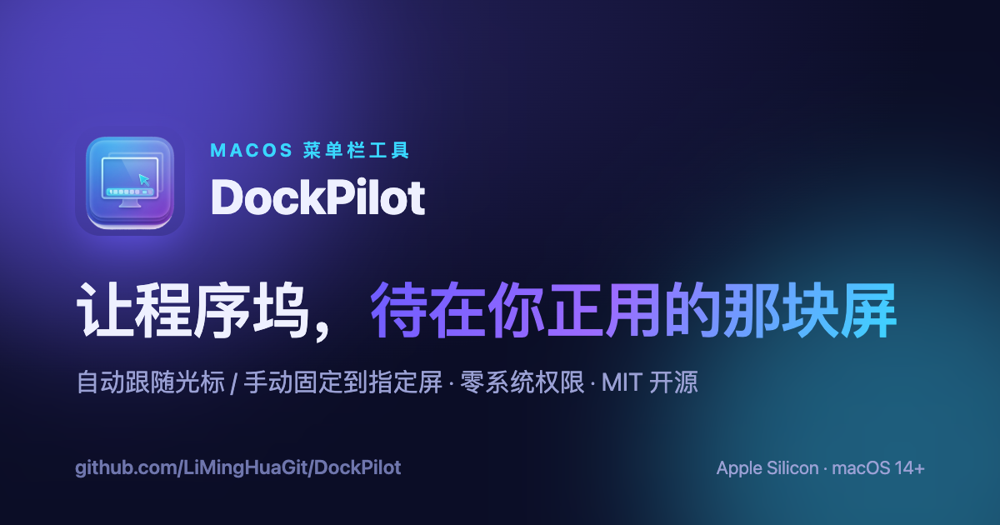

<p align="center">
  <a href="https://dockpilot.liminghua.fyi/">
    
  </a>
</p>

<h1 align="center">DockPilot</h1>

<p align="center">
  A tiny macOS menu-bar app that keeps the <strong>Dock on the display you're actually using</strong>.
</p>

<p align="center">
  
  
  
  
  
</p>

<p align="center">
  <a href="https://github.com/LiMingHuaGit/DockPilot/releases/download/v1.0.1/DockPilot-1.0.1.dmg"><strong>⬇ Download DMG v1.0.1</strong></a>
  &nbsp;·&nbsp;
  <a href="https://dockpilot.liminghua.fyi/">Website</a>
  (<a href="https://dockpilot.liminghua.fyi/en/">EN</a>)
  &nbsp;·&nbsp;
  <a href="#build--run">Build from source</a>
</p>

---

On a multi-monitor Mac the Dock is tied to the *main* display and only moves if
you deliberately shove the cursor to the very bottom edge of another screen.
DockPilot fixes that with **two modes and one switch** — all tucked into the menu bar:

- 🧭 **Auto (follow cursor)** — the Dock moves to whichever display your cursor is
  working on, after a short, configurable delay (0.2–1.2 s) so a quick pass across
  a screen doesn't trigger a switch.
- 📌 **Manual (pin)** — lock the Dock to one display of your choice. DockPilot
  remembers it by a stable display identifier, so it stays put even across sleep
  and display reconnects.

No Accessibility or other permissions are required: cursor tracking uses
`NSEvent.mouseLocation` polling, and changing the main display needs no entitlement.

## Features

| | |
|---|---|
| 🧭 **Auto follow cursor** | Rest the cursor on a display and the Dock follows. Adjustable delay avoids accidental switches. |
| 📌 **Manual pin** | Nail the Dock to the display you choose; it survives sleep and replug. |
| 🔓 **Zero system permissions** | No Accessibility prompt. Polling + the public display-config API, clean and quiet. |
| ▫️ **Lives in the menu bar** | No Dock icon, no window. The menu's top line always shows the current mode; optional launch-at-login. |

## How it works

> **The one trade-off.** macOS exposes no public API to move *only* the Dock.
> The Dock (and the menu bar) live on the **main display**, so DockPilot moves the
> Dock by making the target display the main one via CoreGraphics
> (`CGConfigureDisplayOrigin`). **This means the menu bar moves together with the
> Dock.** That is by design and is the accepted trade-off for reliable behavior.

```
STEP 01  Detect the cursor's display   →   Poll the cursor position to tell which screen you're on.
STEP 02  Set it as the main display    →   CoreGraphics reassigns the main display — no special permission.
STEP 03  The Dock follows              →   Dock and menu bar appear on the screen you're using.
```

## Requirements

- macOS 14 (Sonoma) or later
- Apple Silicon
- For building: Xcode / Swift toolchain (Swift 6+)

## Install

Grab the DMG and drag DockPilot into **Applications**:

**[⬇ Download DockPilot-1.0.1.dmg](https://github.com/LiMingHuaGit/DockPilot/releases/download/v1.0.1/DockPilot-1.0.1.dmg)**

The build is not notarized, so on first launch right-click the app and choose
**Open**. Prefer to build it yourself? See below.

## Build & run

```bash
# Compile and launch (menu-bar only — look for the Dock icon in the status bar)
make run

# Or step by step
make build          # release binary
make app            # assemble build/DockPilot.app (ad-hoc signed)
make install        # copy to /Applications
make dmg            # package a drag-to-install DMG into build/
```

To sign with your own identity (so it launches cleanly on your Mac):

```bash
SIGN_IDENTITY="Apple Development: Your Name (TEAMID)" make dmg
```

Quit from the app's own menu (**退出 DockPilot**).

## Usage

Click the menu-bar icon:

- **模式 (Mode)** — switch between *自动跟随光标* (auto) and *固定到指定屏幕* (manual).
- **屏幕列表 (Displays)** — the current main display is checked; in manual mode, click a
  display to pin the Dock there (`📌`).
- **切换延迟 (Switch delay)** — in auto mode, how long the cursor must rest on a display
  before the Dock follows (0.2–1.2 s). Raise it if switches feel too eager.
- **开机启动 (Launch at login)** — register as a login item (requires a signed `.app`).

## Distribution (signing & notarization)

Ad-hoc signing is fine for personal use. To distribute to others, sign with a
**Developer ID Application** certificate and notarize:

```bash
# 1. Build + sign with your Developer ID (timestamp required for notarization)
SIGN_IDENTITY="Developer ID Application: Your Name (TEAMID)" TIMESTAMP=1 ./scripts/build-app.sh

# 2. Store notary credentials once
xcrun notarytool store-credentials "dockpilot-notary" \
    --key /path/to/AuthKey_XXXX.p8 --key-id XXXX --issuer <issuer-uuid>

# 3. Notarize + staple
make notarize
```

## Project layout

```
Sources/DockPilot/
  main.swift            # entry point (accessory app, no Dock icon)
  AppDelegate.swift     # status-item menu, mode logic, login item
  DisplayManager.swift  # CoreGraphics display enumeration + setMainDisplay
  CursorMonitor.swift   # debounced cursor-position polling
  Settings.swift        # UserDefaults-backed preferences
scripts/                # app bundling, signing, notarization
docs/                   # product landing page (served at dockpilot.liminghua.fyi)
```

## Troubleshooting

**Auto-follow isn't working / "it only works after I switch manually".**
You are probably in **manual** mode. Picking a display once puts the app in
*固定到指定屏幕* (manual), which turns the cursor monitor off. Open the menu and
choose **自动跟随光标** to resume auto-follow. The menu's top line always shows the
current mode. (Mode is remembered across launches.)

**Enable a diagnostic log.** Create the sentinel file, relaunch, reproduce, then
read the log:

```bash
touch /tmp/dockpilot.debug      # turn logging on
open -n /Applications/DockPilot.app
# ... reproduce ...
cat /tmp/dockpilot.log
rm /tmp/dockpilot.debug         # turn logging off
```

## License

[MIT](LICENSE) © 2026 MingHua Li
